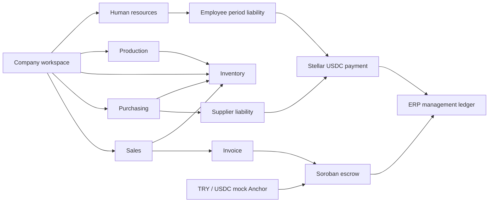

# Centerp — current product scope

Centerp is the company's ERP workspace. The finance module uses Stellar for payments, escrow and reconciliation.

## Production scope in Türkiye

Current fund movements are Testnet demonstrations only; TRY bank movements are simulated. The model to be evaluated for Türkiye is a TL Anchor off-ramp and ERP reconciliation. Real provider integration and legal assessment of the specific fund flow are not yet complete. Direct USDC invoice, supplier and employee flows are not an offer of a real crypto payment service in Türkiye. Details: [legal scope](legal-scope.md).

## 1. What does the product solve?

Customer orders, production, inventory, supplier liabilities, employee payment plans and collections should not remain disconnected across separate records. All core modules should feed one another through shared company and business records. When funds need to move, the company wallet signs the transaction on Stellar Testnet; the verified result returns to the ERP.

The hackathon prototype demonstrates this model as a small, working ERP. It does not claim to cover all enterprise functions at the level of SAP/Logo. The modules are more than visual menus: sales orders create actual invoice links, purchasing creates stock receipts, production consumes inventory, and employee records create period-based liabilities and payment links.

## 2. Modules and connections

| Module | Current working behavior | Stellar connection |
|---|---|---|
| Company profile | Company name, shared workspace, browser session | Company wallet binding through a signed wallet session |
| Customers/vendors | Add and edit type, name, contact details and public key | Invoice buyer or USDC payment recipient |
| Sales | Multi-line orders, precise server-calculated totals, separate shipping and financial status | Soroban invoice with fixed order total and customer key |
| Purchasing | Supplier orders, goods receipt, stock entry, payment obligation | Exact-amount USDC payment linked to the source purchase record |
| Inventory/warehouse | SKU, raw materials/finished goods, quantities, reorder levels, stock movement ledger | Fund movements do not automatically perform stock operations; records are linked by a shared source ID |
| Production | Output quantity, multi-input recipe per unit, planning/completion | Production output feeds sales and delivery; production data does not go on-chain |
| Human resources | Employee, department, role, USDC reference payment plan | USDC transfer linked to an employee + period liability |
| Accounting/finance | Balanced debit/credit management entries; transaction source and hash when available | Create/fund/release/refund and USDC payment results posted to the management ledger |
| Stellar finance | Freighter, balances, trustlines, invoices, escrow, Anchor, transaction ledger | Real Stellar Testnet transactions; mocked TRY/banking/KYC |

## 3. Core workflows

### From sales to collection

1. Create the customer public key and product records.
2. Specify products, quantities and USDC reference unit prices in the sales order.
3. The server calculates the order total using decimal arithmetic.
4. Select `Invoice with Stellar` using the company's verified wallet.
5. The backend checks the company, order ownership, total, customer key and that the order is not already linked to another invoice.
6. The invoice commitment also includes the ERP order ID and a snapshot of the line items.
7. Once the on-chain create is verified, the order is invoiced and an accounts receivable/sales revenue entry is created.
8. The customer can acquire USDC through the Anchor's TRY simulation.
9. Once funding is verified, accounts receivable becomes an escrow receivable. The company has not yet collected the payment.
10. Shipping in the ERP reduces stock. **This step does not release the escrow.**
11. When the customer approves delivery, the on-chain release transfers USDC to the merchant.
12. A verified release marks the order as collected and creates a USDC wallet/escrow receivable entry.

### From purchasing to supplier payment

1. Create a multi-line purchase order by selecting a supplier and products.
2. Goods receipt increases stock, creates a supplier liability and posts an inventory/accounts payable management entry.
3. The same order cannot be received twice.
4. The finance module takes the amount and recipient public key from the ERP record; it does not accept an arbitrary destination/amount from the frontend.
5. The company wallet signs the USDC transfer with Memo.text(ERP payment code).
6. If the Horizon result is successful, the liability becomes `paid` and the hash is stored.
7. Repeat payment preparation is rejected. An uncertain network result does not mark the liability as paid.

### From production to inventory

1. Record the output product, quantity and inputs required per unit in the work order.
2. Planning does not consume or reserve stock.
3. Completion checks the available stock of all inputs.
4. Consumption movements, the output movement and the work order status are written in a single SQLite transaction.
5. If a later input has insufficient stock, earlier consumption is also rolled back.
6. A completed work order cannot be completed again.
7. Produced stock can be used in sales shipments.

### From employee records to period-based payments

1. Record the employee's name, role, department, monthly USDC reference amount and recipient key.
2. Selecting a period creates a payment obligation for each employee.
3. The same employee + month is not charged again; a missing entry for an employee added later can be created for that month.
4. The period liability amount is a snapshot; changes to the employee's payment plan do not change historical liabilities.
5. The company wallet signs the individual USDC payment from the finance module.
6. After on-chain success, the liability and accounting entry are updated.

This feature is a **payment plan**; it does not calculate statutory payroll, Turkish social security (SGK), withholding tax, net/gross wages, leave or benefits.

## 4. Where is data stored?

Regular ERP data is stored in SQLite: companies, business partner contact details, employees/roles, recipes, inventory, orders and management entries.

Public keys, USDC amounts, escrow invoice commitments/states and payment transactions are on-chain. Contact details and employee HR files are not written to the blockchain. Supplier/employee payments include a short ERP payment code in the memo; personal names, departments and monthly payment periods are not included in the memo.

## 5. Company identity and wallet identity are different

The ERP workspace opens with a strong random bearer token in the `erp_workspace` HttpOnly/SameSite cookie; the database stores the token hash. Each browser session sees a separate company workspace. Writing to another company's products, orders or employees by reference is blocked.

Stellar authority is verified separately through `bridge_session`. A genuine signed wallet session is required to bind the company wallet and prepare fund transfers. The ERP cookie alone does not authorize Stellar fund movements.

November 5, 2026 update: signed company membership, role-based server permissions, adding/revoking members by public key, rejoining through membership verification with a company ID, and an application audit log have been added. Anonymous workspaces are only for isolated demos; claimed companies require signed membership. Company owner key recovery/transfer and enterprise SSO are not yet available. Details: [authentication and permissions](../architecture/auth-and-roles.md). Customers can view their own Stellar invoices through the finance module; they cannot view the merchant's ERP operational data.

## 6. Accounting entries

| Event | Debit account | Credit account |
|---|---|---|
| Goods receipt | Inventory | Accounts payable |
| Employee period accrual | Personnel expenses | Employee payables |
| Verified sales invoice | Accounts receivable | Sales revenue |
| Verified escrow funding | Escrow receivables | Accounts receivable |
| Verified release | USDC wallet | Escrow receivables |
| Verified refund | Accounts receivable | Escrow receivables |
| Sales closure after refund | Sales revenue | Accounts receivable |
| Unfunded cancellation/expiry | Sales revenue | Accounts receivable |
| Verified supplier payment | Accounts payable | USDC wallet |
| Verified employee payment | Employee payables | USDC wallet |

Entry IDs are derived from company + source + event; repeating the same verification does not create a second journal entry. All amounts use USDC as the reference currency. TRY exchange differences, Anchor fee accounting, inventory valuation, COGS, taxes and a statutory chart of accounts are not included. This ledger must not be used in place of a bank statement or statutory balance sheet. Since physical return stock movements are not separately supported in this release, an escrow refund does not automatically increase stock quantities.

## 7. Sample data and accuracy

Sample records are added only at the user's request in an empty workspace. Record names are marked as sample/demo, and the workspace displays a warning. Loading sample data does not create payments, on-chain invoices, collections, successful chain operations or transaction hashes.

Sample order amounts are operational references; verified Stellar collections are shown in a separate card. Unrecorded or unverified fund movements are not presented as successful.

## 8. Verification and evidence

`npm test` verifies company isolation, amount calculations, signed sessions, stock operations, unique period liabilities and ERP payment reconciliation.

`npm run contract:test`: 12 Rust tests for escrow v2.

Escrow v2 includes delivery reporting, a 3-day dispute window, an independent resolver and a 7-day refund fallback if the resolver remains silent. Rules: [escrow v2](../architecture/escrow-v2.md).

`npm run test:erp`: an ERP → Stellar end-to-end test with two fresh temporary Testnet accounts.

September 18, 2026 test results:

- A purchase was received; stock and a supplier liability were created.
- Production inputs were consumed and three finished goods were produced.
- A 3 USDC sales order was invoiced for the correct amount; an entry with a different amount was rejected.
- TRY bank simulation and escrow funding were completed.
- ERP shipping was confirmed not to release funds.
- The customer released the funds; the ERP order was marked as collected.
- A 1 USDC supplier liability and a 0.5 USDC employee liability were paid through real Testnet transactions.
- Duplicate goods receipt, duplicate period liabilities, unauthorized payments and repeat payments were rejected.
- Seven source-linked management entries were created.

Testnet evidence: [ERP v2 workflow](../../artifacts/erp-testnet-v2-proof.json).

## 9. Future scope

Membership/roles and an application audit log have been added. Future scope includes owner wallet recovery, an immutable audit archive, sales/purchasing approval steps, physical returns, partial delivery, lot/serial/warehouse tracking, costing, a real ERP adapter and exports. These are not presented as completed features of the current hackathon prototype.

For Stellar: a submission journal, worker capacity and monitoring, webhook-based reconciliation, a multisig company account, batch payments, fee sponsorship and eventual real Anchor integration. The current network is Testnet only.
